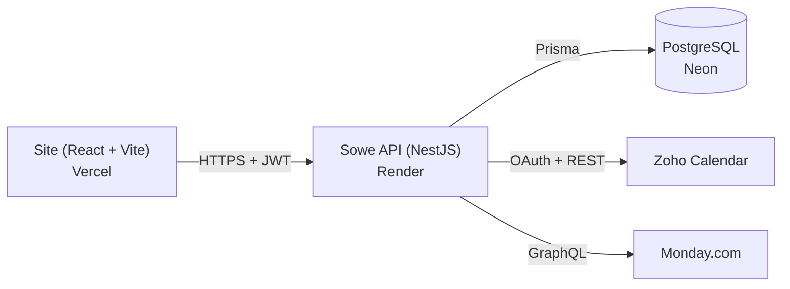

# Sowe API

API do **Sowe Studio**, feita em [NestJS](https://nestjs.com) + TypeScript. Cuida de autenticação, usuários e do calendário de agendamentos (integrado ao Zoho Calendar). É consumida pelo site: [Sowe-Site](https://github.com/Soweoff/Sowe-Site).

[](https://github.com/Soweoff/sowe-backend/actions/workflows/ci.yml)

## Arquitetura



| Tecnologia | Para que serve |
|---|---|
| NestJS 11 | Controllers, services, módulos, guards e validação |
| Prisma 5 + PostgreSQL (Neon) | Acesso ao banco (hoje só a tabela de usuários) |
| JWT + Passport | Autenticação por token (`Authorization: Bearer ...`) |
| bcrypt | Hash das senhas |
| Swagger | Documentação interativa em `/api` |
| Jest | Testes automatizados |

> Os eventos do calendário **não** são gravados no banco: ficam no Zoho Calendar e a API só lê e escreve neles.

## Endpoints

Documentação completa e testável em **`/api`** (Swagger). Resumo:

| Método | Rota | Acesso |
|---|---|---|
| `POST` | `/v1/auth/register` | Público (cria usuário `USER` e devolve o token) |
| `POST` | `/v1/auth/login` | Público (devolve `access_token`) |
| `GET` | `/v1/users` · `/v1/users/:id` | `ADMIN` |
| `POST` `PUT` `DELETE` | `/v1/users` · `/v1/users/:id` | `ADMIN` |
| `GET` | `/zoho/events?calendar=personal\|tnk_store` | Usuário logado |
| `POST` `PUT` `DELETE` | `/zoho/events` · `/zoho/events/:id` | `ADMIN` |
| `GET` | `/monday/tasks` | `ADMIN` |
| `GET` | `/health` | Público (monitoramento) |

Papéis: `USER` (padrão) e `ADMIN`. O papel vai dentro do token JWT e é conferido no servidor pelo `RolesGuard`.

## Segurança

- Senhas com **bcrypt**; o hash nunca é devolvido nas respostas.
- Rotas protegidas por `JwtAuthGuard` e, quando necessário, `RolesGuard` (`@Roles('ADMIN')`).
- `ValidationPipe` com `whitelist` e `forbidNonWhitelisted`: campos não previstos são recusados.
- **Limite de tentativas de login:** 5 senhas erradas por conta e IP (15 min) e 30 por conta (1 h), além de limites gerais por IP no login e no cadastro. O estado fica em memória e zera quando a API reinicia.
- Cabeçalhos de segurança (`X-Content-Type-Options`, `X-Frame-Options`, HSTS etc.) e CORS restrito aos domínios do site.
- Segredos só em variáveis de ambiente (nunca no repositório). Veja `.env.example`.

## Rodando localmente

Pré-requisitos: Node.js 22+ e um banco PostgreSQL (pode ser um banco gratuito da Neon).

```bash
npm install
cp .env.example .env        # preencha DATABASE_URL e JWT_SECRET
npx prisma generate
npx prisma db push          # cria as tabelas (o repositório não tem migrations)
npm run start:dev           # http://localhost:3000  ·  Swagger em /api
```

### Criar (ou trocar a senha do) administrador

```bash
# Linux/macOS
ADMIN_EMAIL=voce@email.com ADMIN_PASSWORD='uma-senha-forte' npm run create-admin
```

```powershell
# Windows (PowerShell)
$env:ADMIN_EMAIL="voce@email.com"; $env:ADMIN_PASSWORD="uma-senha-forte"; npm run create-admin
```

A senha precisa ter pelo menos 10 caracteres e nunca deve ser escrita no código.

## Variáveis de ambiente

| Variável | Obrigatória | Descrição |
|---|---|---|
| `DATABASE_URL` | Sim | Conexão PostgreSQL (Neon) |
| `JWT_SECRET` | Sim | Segredo para assinar os tokens (longo e aleatório) |
| `JWT_EXPIRES_IN` | Não | Validade do token (padrão `1d`) |
| `PORT` | Não | Porta (o Render define sozinho) |
| `CORS_ORIGINS` | Não | Domínios do site, separados por vírgula |
| `TRUST_PROXY_HOPS` | Não | Proxies na frente da API (padrão `1`); define qual IP aparece nos logs e nos limites |
| `ZOHO_CLIENT_ID` · `ZOHO_CLIENT_SECRET` · `ZOHO_REFRESH_TOKEN` | Para o calendário | Credenciais OAuth do Zoho |
| `ZOHO_CALENDAR_ID` · `ZOHO_TNK_STORE_CALENDAR_ID` | Para o calendário | IDs dos calendários `personal` e `tnk_store` |
| `ZOHO_PERSONAL_NOTIFICATION_EMAIL` | Não | E-mail que recebe os avisos dos eventos |
| `ZOHO_ACCOUNTS_URL` · `ZOHO_CALENDAR_API_URL` | Não | Só se a conta Zoho não for da região `.com` |
| `MONDAY_TOKEN` | Para o Monday | Token da API do Monday |

## Scripts

| Comando | O que faz |
|---|---|
| `npm run start:dev` | Servidor com recarga automática |
| `npm run build` | Compila para `dist/` |
| `npm run start:prod` | Roda a versão compilada |
| `npm test` | Testes unitários (Jest) |
| `npm run lint` | ESLint |
| `npm run create-admin` | Cria/atualiza o administrador |

## Testes e integração contínua

O workflow `.github/workflows/ci.yml` roda a cada push e pull request: instala as dependências, gera o Prisma Client, compila e executa os testes. Os testes cobrem autenticação, usuários, regras de acesso por papel, limite de tentativas e a lógica de cache de token e novas tentativas do Zoho.

## Deploy

- **API:** Render (Web Service Node). Configure as variáveis acima no painel do Render. Sugestão de comandos (confira os seus): build `npm install && npx prisma generate && npm run build`, start `npm run start:prod`.
- **Banco:** Neon (PostgreSQL).
- No plano gratuito do Render a API hiberna por inatividade (a primeira requisição pode levar cerca de 1 minuto). Um monitor chamando `/health` a cada 5 minutos evita isso.

## Estrutura

```
src/
  auth/        login, cadastro, JWT, guards de autenticação e de papéis
  users/       CRUD de usuários (somente ADMIN)
  zoho/        integração com o Zoho Calendar (token em cache, novas tentativas)
  monday/      integração com o Monday
  health/      rota de monitoramento
  common/      filtros, interceptors, middlewares e utilidades de segurança
prisma/        schema e PrismaService
scripts/       utilitários (create-admin)
```
